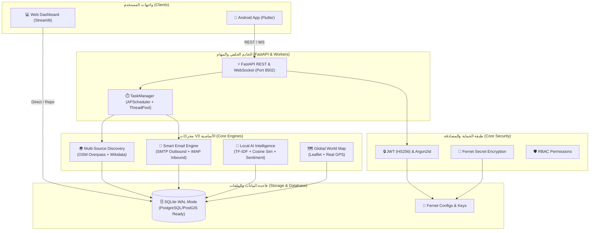

# AutoLeadGen V3 — المعمارية الهندسية الشاملة

منصة عالمية متكاملة لاكتشاف الشركات، وإدارة علاقات العملاء (CRM)، وذكاء التواصل بالبريد الإلكتروني، والتحكم عن بُعد عبر تطبيق Android.

---

## المكونات المنجزة في V3:

1. **Global Business Discovery Engine**:
   - `integrations/overpass_discovery.py`: بحث جغرافي متدفق عبر OpenStreetMap Overpass API مع احترام حدود الاستخدام المجاني (1 req/sec).
   - `integrations/wikidata_discovery.py`: استعلامات SPARQL لاكتشاف الشركات مع إحداثيات GPS حقيقية بدون تكاليف.
   - `integrations/multi_source_discovery.py`: دمج متعدد المصادر، وإلغاء التكرار عبر 5 مستويات، وحفظ نقاط التوقف (Checkpoints) للاستئناف التلقائي.

2. **Global Business Map**:
   - استخراج وتخزين خطوط الطول والعرض الحقيقية (`latitude`, `longitude`).
   - إزالة الإحداثيات العشوائية ومنع وضع أي علامة دون إحداثيات مؤكدة.
   - تجميع العلامات (Marker Clustering) وعرض تفاصيل الشركة بنقرة واحدة.

3. **Local AI Lead Intelligence**:
   - `services/ai_service.py`: تصنيف مجالات العمل، تقييم اكتمال البيانات (Data Completeness)، تلخيص النصوص، واكتشاف التكرار الدلالي (Semantic Deduplication) محلياً 100% دون الحاجة لاشتراكات مدفوعة.

4. **Inbound Email & Reply Intelligence**:
   - `integrations/imap_listener.py`: استقبال البريد عبر IMAP، مطابقة الردود بالشركات في CRM، تصنيف مشاعر الرد (`interested`, `not_interested`, `follow_up`, `out_of_office`)، وإرسال إشعارات فورية.

5. **FastAPI & WebSocket Backend**:
   - `api/main.py`: خادم REST + WebSocket متكامل مؤمن بـ JWT وArgon2 وRBAC لربط تطبيق الهاتف واللوحة.

6. **Flutter Android Mobile App**:
   - تطبيق مستقل كامل في مجلد `mobile/` مع ملف APK جاهز في `build/app/outputs/flutter-apk/app-release.apk`.
